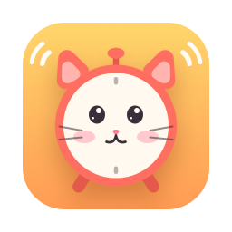

<p align="center">
  
</p>

# 알림펫 🐾

노트북 화면에 귀여운 펫을 띄워두면, 카톡·디스코드 같은 **알림이 올 때 펫이 말풍선으로 말해주고**, 정해둔 시간에는 **알람시계처럼 울려주는** macOS 앱이에요.

```
        ┌──────────────────────────┐
        │ 집가고싶어ㅠㅠ              │
        │ 💬 카카오톡       - 손범수  │
        └────────────┬─────────────┘
                     ▼
                  (=^･ω･^=)
```

- 내가 고른 GIF·PNG·영상으로 펫을 띄우고, **크기와 각도를 마음대로** 바꿀 수 있어요.
- 알림이 오면 펫 머리 위에 말풍선이 뜨고, 원래 오른쪽 위 알림은 알아서 닫혀요.
- 펫마다 **말할 앱, 말풍선 크기, 소리, 알람**을 따로 정할 수 있어요.

> 개발 명세서(무엇을 왜 어떻게 만들었는지)는 [docs/SPEC.md](docs/SPEC.md)에 있어요.

---

## 목차

1. [준비물](#1-준비물)
2. [설치](#2-설치)
3. [처음 실행하면](#3-처음-실행하면)
4. [펫 꾸미기](#4-펫-꾸미기)
5. [알림 말풍선](#5-알림-말풍선)
6. [알람](#6-알람)
7. [메뉴바 메뉴 한눈에 보기](#7-메뉴바-메뉴-한눈에-보기)
8. [문제 해결](#8-문제-해결)
9. [삭제하기](#9-삭제하기)

---

## 1. 준비물

- **macOS 14 (Sonoma) 이상** (macOS 26 + Command Line Tools(Swift 6.4)에서 확인했어요. 그보다 오래된 환경은 아직 테스트하지 못했어요)
- **Xcode Command Line Tools**: Xcode 앱은 필요 없어요.
- 터미널 사용이 조금 필요해요. 명령어는 아래에 그대로 복사해서 붙여넣으면 돼요.

---

## 2. 설치

### ① Command Line Tools 설치 (처음 한 번)

터미널을 열고:

```bash
xcode-select --install
```

이미 설치돼 있으면 "already installed"라고 나와요. 그러면 넘어가면 돼요.

### ② 알림펫 코드 받기

```bash
git clone https://github.com/sonbumsu/NotiPet.git
cd NotiPet
```

git이 없다면 [GitHub 페이지](https://github.com/sonbumsu/NotiPet)에서 **Code → Download ZIP**으로 받아 압축을 풀고, 터미널에서 그 폴더로 이동해도 돼요 (`cd ~/Downloads/NotiPet-main`).

> 아래 명령에서 `permission denied`가 나오면 앞에 `bash`를 붙여서 실행하세요. 예) `bash build.sh --run`

### ③ 서명 인증서 만들기 (처음 한 번, 권장)

```bash
./scripts/setup-signing.sh
```

내 맥에서만 쓰는 서명용 인증서를 하나 만들어요. 이 인증서가 없으면 **다시 빌드할 때마다 "손쉬운 사용" 권한이 풀려서** 매번 다시 허용해야 해요.

### ④ 빌드하고 실행

```bash
./build.sh --run
```

- `build/NotiPet.app`이 만들어지고 바로 실행돼요.
- 처음 빌드할 때 **"codesign이 키체인의 'NotiPet Dev' 키를 사용하려고 합니다"** 창이 뜨면, 맥 로그인 비밀번호를 넣고 **[항상 허용]**을 눌러 주세요.
- 실행하지 않고 빌드만 하려면 `./build.sh`만 입력하면 돼요.

### ⑤ (선택) 응용 프로그램 폴더로 옮기기

계속 쓸 거라면 앱을 응용 프로그램 폴더로 옮겨 두면 편해요.

```bash
cp -R build/NotiPet.app /Applications/
open /Applications/NotiPet.app
```

그다음 펫 설정에서 **"로그인 시 자동 실행"**을 켜면 맥을 켤 때마다 알아서 실행돼요.

### ⑥ 업데이트하기 (새 기능 받기)

알림펫은 저절로 업데이트되지 않아요. 새 버전이 올라오면 직접 받아서 다시 빌드해 주세요.

**git clone으로 받았다면** 알림펫 폴더에서:

```bash
git pull
./build.sh --run
```

**ZIP으로 받았다면** ZIP을 다시 받아 압축을 풀고, 그 폴더에서 `./build.sh --run`을 실행해요.

**응용 프로그램 폴더로 옮겨서 쓰고 있다면** 빌드한 다음 새 앱으로 바꿔 넣어요.

```bash
osascript -e 'quit app "NotiPet"'
rm -rf /Applications/NotiPet.app
cp -R build/NotiPet.app /Applications/
open /Applications/NotiPet.app
```

- 펫, 위치·크기, 알람, 내 소리, 설정은 그대로 남아 있어요 (`~/Library/Application Support/NotiPet`에 따로 저장돼요).
- 인증서(③)를 만들어 뒀다면 손쉬운 사용 권한도 그대로예요. 인증서 없이 쓰고 있다면 권한을 다시 줘야 해요 → [권한을 줬는데도 안 돼요](#권한을-줬는데도-안-돼요)

#### AlarmPet을 쓰고 있었다면 (한 번만)

영어 이름이 **AlarmPet → NotiPet**으로 바뀌었어요. `git pull`은 그대로 돼요(GitHub이 예전 주소를 새 주소로 연결해 줘요).

- 펫, 알람, 내 소리, 알림 설정(Klipy 키 포함)은 NotiPet을 처음 켤 때 **자동으로 옮겨져요.**
- 앱이 새 앱으로 인식돼서 아래는 **다시 해줘야 해요.**
  - 처음 켤 때 펫 파일이 있는 폴더(iCloud Drive, 다운로드 등)에 접근해도 되는지 묻는 창이 뜨면 **[허용]**을 눌러요.
  - 손쉬운 사용 권한: 시스템 설정 → 개인정보 보호 및 보안 → 손쉬운 사용에서 **NotiPet**을 켜고, 예전 **AlarmPet**은 지워요.
  - 로그인 시 자동 실행: 펫 설정에서 다시 켜고, 시스템 설정 → 일반 → 로그인 항목에서 **AlarmPet**은 지워요.
- 응용 프로그램 폴더에 예전 앱이 있으면 지워요.

```bash
osascript -e 'quit app "AlarmPet"'
rm -rf /Applications/AlarmPet.app
cp -R build/NotiPet.app /Applications/
open /Applications/NotiPet.app
```

---

## 3. 처음 실행하면

- 화면에 **기본 펫(알람시계 고양이)**이 나타나요. 통통 뛰면서 가끔 눈을 깜빡여요.
- 화면 위 **메뉴바에 고양이 귀 알람시계 아이콘**이 생겨요. 알림펫의 모든 메뉴는 여기서 열어요.
- Dock에는 아이콘이 나오지 않아요. 원래 그렇게 만든 거예요.

바로 확인해 보기: 메뉴바 아이콘 → **말풍선 테스트**를 누르면 펫 위에 이렇게 떠요.

```
테스트입니다.
테스트          - 테스트
```

---

## 4. 펫 꾸미기

### 내 캐릭터로 바꾸기

- 메뉴바 아이콘 → **펫 추가…** → 파일을 고르면 새 펫이 생겨요. 여러 개를 한 번에 골라도 돼요.
- 이미 있는 펫을 바꾸려면 **파일을 펫 위로 끌어다 놓거나**, 펫 설정 → **파일 바꾸기…**를 눌러요.

### 기본 펫(알람시계 고양이) 꺼내기

- 메뉴바 아이콘 → **기본 펫 추가 (알람시계 고양이)**: 파일 없이 기본 펫이 하나 새로 생겨요.
- 펫 설정 → 펫 탭 → **기본 펫으로 바꾸기**: 지금 펫의 그림만 기본 고양이로 되돌려요. 이름·크기·알림·알람 설정은 그대로예요.

| 지원 형식 | 투명 배경 |
|---|---|
| GIF | ✅ |
| APNG / PNG | ✅ |
| PNG 시퀀스 (이미지가 든 폴더) | ✅ |
| MOV (ProRes 4444, HEVC with Alpha) | ✅ |
| MP4 / 일반 MOV | ❌ (배경이 보여요) |

> 투명 배경 GIF를 찾는 팁: [tenor.com](https://tenor.com)에서 캐릭터를 검색하고, 배경이 있으면 [배경 제거 사이트](https://onlinegiftools.com/remove-gif-background)로 지우면 돼요.

### 이동·크기·각도

| 하고 싶은 것 | 방법 |
|---|---|
| **옮기기** | 펫을 드래그 |
| **크기** | `⌘` 누르고 스크롤 · 트랙패드 핀치 · `⌘ =` / `⌘ -` / `⌘ 0`(원래 크기) |
| **각도** | `⌥` + `←` / `→` (5°씩), `⌥⇧` + `←` / `→` (1°씩) |
| **손으로 직접** | **`⌥ Option`을 누른 채** 펫에 마우스를 올리면 핸들이 나와요. 모서리 □를 끌면 크기, 위쪽 ○를 끌면 회전(`⇧` 누르면 15°씩) |
| **되돌리기** | 펫 우클릭 → 각도 초기화 / 크기 초기화 |

- 키보드 단축키는 펫을 한 번 클릭해서 선택한 다음에 써요.
- 펫의 투명한 부분은 클릭이 뒤에 있는 창으로 그대로 넘어가서 작업에 방해가 되지 않아요.

### 펫 설정 창

펫 **우클릭 → 설정…** (또는 메뉴바 아이콘 → 펫 이름 → 설정…)을 누르면 탭 3개가 있어요.

| 탭 | 들어 있는 것 |
|---|---|
| **펫** | 이름, 파일 바꾸기, 기본 펫으로 바꾸기, 재생/속도, 투명도, 크기(숫자 입력 가능), 각도(숫자 입력 가능), 항상 위에, 클릭 통과, 위치·크기 잠금, 로그인 시 자동 실행, 펫 삭제 |
| **알림** | 이 펫이 말할지, 말풍선 크기, 표시 시간, 알림 소리, 말할 앱 → [5장](#5-알림-말풍선) |
| **알람** | 이 펫의 알람 목록과 알람 소리 → [6장](#6-알람) |

- **클릭 통과**를 켜면 펫을 클릭할 수 없게 돼요. 이때는 메뉴바 아이콘 → 펫 이름 → 설정…으로 들어가요.
- **위치·크기 잠금**을 켜면 실수로 옮기거나 크기를 바꾸지 않아요.
- 펫은 여러 마리 띄울 수 있고, 설정은 펫마다 따로예요. 앱을 껐다 켜도 그대로 남아 있어요.

---

## 5. 알림 말풍선

### ① 시스템 알림 읽기 켜기 (처음 한 번)

1. 메뉴바 아이콘 → **알림 설정…** → **"시스템 알림 읽기 (카카오톡 등)"** 켜기
2. 권한 요청 창이 뜨면 **시스템 설정 → 개인정보 보호 및 보안 → 손쉬운 사용**에서 **NotiPet**을 켜기
3. 이제 화면 오른쪽 위에 macOS 알림이 뜨면 펫이 말풍선으로 말해요.

> 왜 "손쉬운 사용" 권한이 필요하냐면, macOS에는 다른 앱의 알림을 읽는 공식 기능이 없어서 **화면에 뜬 알림 배너를 읽는 방식**을 쓰기 때문이에요. 알림 내용은 맥 밖으로 보내지 않아요.

### ② 말풍선 모양

```
┌──────────────────────────────┐
│ 집가고싶어ㅠㅠ                  │  ← 내용 (크게, 최대 3줄)
│ 💬 카카오톡           - 손범수  │  ← 앱 아이콘·앱 이름 / 보낸 사람
└──────────────┬───────────────┘
               ▼
```

- 정해둔 시간(기본 5초)이 지나면 사라지고, **클릭하면 바로 닫혀요.**
- 알림이 여러 개 오면 하나씩 차례로 말해요.
- 내용에 **움짤 링크**(Tenor, Giphy, `.gif`·`.png`·`.jpg` 주소)가 있으면 링크 대신 **움짤을 말풍선 안에서 보여줘요.**
  받는 동안은 "🎞️ 움짤 불러오는 중…"이 뜨고, 못 받으면 원래처럼 링크 글자로 보여요.
- 디스코드 GIF 버튼으로 보낸 움짤(`klipy.com/gifs/...`)은 **Klipy API 키**가 있어야 보여요.
  [docs.klipy.com](https://docs.klipy.com)에서 키를 받아 🐾 → **알림 설정…** → **움짤** 칸에 붙여넣으세요. 키가 없으면 링크 글자로 보여요.

### ③ 펫마다 다르게 설정하기 (펫 설정 → 알림 탭)

| 옵션 | 설명 |
|---|---|
| 이 펫이 알림 말하기 | 끄면 이 펫은 알림을 말하지 않아요 |
| 말풍선 크기 | 70% ~ 200% |
| 표시 시간 | 2 ~ 15초 |
| 말할 때 통통 튀기 | 말하는 동안 펫이 통통 튀어요 |
| 알림 소리 | 뿅 · 삐롱 · 뽀잉 / macOS 기본 소리 / **내 소리** / 없음, 볼륨 조절 |
| 소리 내서 읽기 (TTS) | 알림 내용을 한국어 음성으로 읽어줘요 |
| **말해줄 앱** | 비워두면 모든 앱. 쉼표로 구분해요. 예) `카카오톡, Discord` |
| **무시할 앱** | 이 앱 알림은 말하지 않아요. 예) `메일` |

- 알림이 오면 **조건에 맞는 펫이 모두** 각자 말풍선으로 말해요. 예를 들어 펫 A는 카카오톡만, 펫 B는 디스코드만 말하게 할 수 있어요.
- 앱 이름은 한글·영어 다 알아들어요. `카카오톡`이든 `KakaoTalk`이든 같은 앱이에요. 다만 **철자가 정확해야 해요** (`Kakaotok` ❌).

### ④ 원래 알림 숨기기

알림 설정의 **"원래 알림 배너 숨기기"**(기본으로 켜져 있음)를 켜두면, 펫이 말한 알림은 오른쪽 위의 원래 배너를 알림펫이 바로 닫아요.

- 알림 센터 기록에는 그대로 남아요.
- 펫이 말하지 않는 알림(필터로 제외한 앱 등)은 원래 배너가 그대로 떠요.
- 배너가 아주 잠깐 비쳤다가 닫힐 수 있어요.
- **소리가 두 번 날 때:** 원래 앱의 알림음이 따로 울리는 거예요. 시스템 설정 → 알림 → 해당 앱 → "알림 사운드 재생"을 끄면 펫 소리만 나요.

### ⑤ 앱 전체 설정 (메뉴바 아이콘 → 알림 설정…)

| 옵션 | 설명 |
|---|---|
| 알림 말풍선 켜기 (모든 펫) | 잠깐 모든 펫을 조용히 시키고 싶을 때 끄면 돼요 |
| 앱 이름 바꾸기 | 한 줄에 하나씩 `원래이름=보여줄이름`. 예) `KakaoTalk=카톡` |
| 시스템 알림 읽기 / 원래 알림 배너 숨기기 | 위 ①, ④ 참고 |
| 로컬 HTTP로 말 시키기 / 포트 | 아래 ⑥ 참고 |
| 움짤 → Klipy API 키 | 디스코드 GIF 버튼 움짤을 보여줄 때 써요. 위 ② 참고 |

### ⑥ 터미널·스크립트에서 펫에게 말 시키기

알림펫이 켜져 있으면 내 맥 안에서만 쓰는 주소(`localhost:7777`)로 펫에게 말을 시킬 수 있어요.
포트 번호(7777)는 알림 설정에서 바꿀 수 있어요. 다른 프로그램이 그 번호를 쓰고 있으면 설정 창에 알려줘요.

```bash
# 기본
curl -X POST localhost:7777/say -d '{"app":"터미널","body":"빌드 끝!"}'

# 보낸 사람까지
curl -X POST localhost:7777/say -d '{"app":"카카오톡","body":"집가고싶어ㅠㅠ","sender":"손범수"}'

# 특정 펫에게만 ("pet": 펫 이름)
curl -X POST localhost:7777/say -d '{"app":"터미널","body":"테스트 통과","pet":"kurukuru"}'

# 긴 작업이 끝나면 알려주기
npm run build && curl -X POST localhost:7777/say -d '{"app":"터미널","body":"빌드 성공 🎉"}'
```

---

## 6. 알람

알람은 **펫마다 따로** 만들고, 시간이 되면 **진짜 알람시계처럼** 울려요.

### 만들기

펫 우클릭 → 설정… → **알람** 탭 (또는 메뉴바 아이콘 → **알람…**)

1. **할 일**을 적어요. 예) 물 마시기
2. **시간**을 정해요.
3. **요일**을 골라요. 안 고르면 한 번만 울리고 자동으로 꺼져요.
4. **[추가]**를 눌러요.

바로 쓰고 싶으면 **빠른 추가** 버튼(5분 뒤 / 10분 뒤 / 30분 뒤 / 1시간 뒤)을 누르면 돼요.

- **목록에서 알람을 누르면 수정**할 수 있어요. 위쪽 칸에 내용이 채워지면 고친 다음 **[저장]**을 눌러요(**[취소]**로 그만두기).
- 스위치로 켜고 끌 수 있고, 🗑로 지워요.
- 이미 울린 한 번짜리를 다시 켜면 다음 그 시각에 울려요.

### 울릴 때

```
┌───────────────────────────┐
│ ⏰ 07:30                   │
│ 일어나기                    │
│ [5분 뒤 다시]  [끄기]        │
└────────────┬──────────────┘
             ▼
          (펫이 덜덜 흔들림)
```

- 소리가 **끄기 전까지 계속 반복**되고, 작게 시작해서 점점 커져요.
- **[끄기]**로 끄고, **[5분 뒤 다시]**를 누르면 5분 뒤에 다시 울려요. 메뉴바 아이콘 → **⏰ 알람 끄기**로도 끌 수 있어요.
- "5분 뒤 다시"는 저장돼서 **앱을 껐다 켜도** 그 시각에 울려요. 목록에는 `💤 07:35에 다시 울려요`라고 보여요. 앱이 꺼져 있는 동안 그 시각이 지나갔다면, 켤 때 30분 안에 놓친 것만 울려요.
- 숨겨 둔 펫이어도 다시 나타나서 울려요. "알림 말풍선 (모든 펫)"을 꺼둬도 알람은 울려요.
- 10분 동안 안 끄면 소리만 멈추고 말풍선은 **"놓친 알람"**으로 남아요.
- 맥이 잠자기 중이었으면, 깨어났을 때 30분 안에 놓친 알람만 울려요.

### 알람 소리

알람 탭 아래에서 펫마다 고를 수 있어요. 따르릉 · 삐삐삐삐 · 딩동댕 · 뽀잉뽀잉 / macOS 기본 소리 / 내 소리 중에서 고르고, 🔊로 미리 듣고, 볼륨도 조절해요. **[알람 테스트]**를 누르면 바로 울려 볼 수 있어요.

### 내 소리 (원하는 음성 파일 쓰기)

알림 소리와 알람 소리 모두 내 음성 파일로 바꿀 수 있어요.

1. 펫 설정 → **알림 탭**(알림 소리) 또는 **알람 탭**(알람 소리)에서 **[내 소리 추가…]**를 눌러요.
2. mp3 · m4a · wav · aiff 파일을 고르면 바로 그 소리로 바뀌어요.
3. 한 번 추가한 소리는 모든 펫의 소리 목록 **"내 소리"** 칸에 나와요.

- 파일은 알림펫 폴더(`~/Library/Application Support/NotiPet/Sounds`)에 복사돼요. 그래서 원본 파일을 옮기거나 지워도 계속 울려요.
- 알람으로 쓰면 파일을 **끝까지 다 들려준 다음 처음부터 다시** 재생해요. 끄기 전까지 계속 반복해요 (10분 동안 안 끄면 "놓친 알람"이 돼요).
- 알림 소리로 쓰면 말풍선이 떠 있는 동안만 나와요. 설정 창의 🔊 미리 듣기도 8초까지만 들려줘요. 전체를 들어 보려면 **[알람 테스트]**를 누르세요.
- 내 소리를 고른 상태에서 **[‘이름’ 삭제]**를 누르면 목록에서 지워져요. 그 소리를 쓰던 다른 펫은 기본 소리로 울려요.

> 맥 전체 음량이 꺼져 있으면 알람도 안 들려요.

---

## 7. 메뉴바 메뉴 한눈에 보기

| 메뉴 | 하는 일 |
|---|---|
| ⏰ 알람 끄기 | 알람이 울리고 있을 때만 보여요 |
| 펫 추가… | 파일을 골라 새 펫 만들기 |
| 기본 펫 추가 (알람시계 고양이) | 파일 없이 기본 펫 만들기 |
| 모두 숨기기 / 모두 보이기 | |
| (펫 이름) → 설정… / 숨기기 / 삭제 | 펫마다 |
| 알림 말풍선 (모든 펫) | 전체 켜기/끄기 |
| 알림 설정… | 앱 전체 알림 설정 |
| 말풍선 테스트 | 보이는 펫 모두에게 테스트 말풍선 |
| 알람… | 펫의 알람 탭 열기 |
| 다음 알람: … | 가장 가까운 알람 |
| 최근 알림 | 최근 10개 |
| 알림펫 종료 | |

---

## 8. 문제 해결

### 펫이 알림을 말하지 않아요

아래를 순서대로 확인해 보세요.

1. **알림 설정 → "시스템 알림 읽기"**가 켜져 있나요?
2. 알림 설정에 **"손쉬운 사용 권한이 필요해요"**가 보이나요? → 아래 "권한을 줬는데도 안 돼요"를 보세요.
3. **화면 오른쪽 위에 macOS 알림이 실제로 뜨나요?**
   - 안 뜬다면 알림펫이 읽을 게 없어요. 원인은 그 앱 쪽에 있어요.
   - 시스템 설정 → 알림 → 해당 앱에서 "알림 허용"을 켜고, 데스크탑에 표시되게 해 주세요.
   - **카카오톡:** 카톡 → 설정 → 알림이 켜져 있는지, 그 채팅방 알림(종 모양)이 꺼져 있지 않은지 확인해 주세요. **카톡 창을 보고 있을 때나 휴대폰에서 먼저 읽었을 때는 맥에 알림이 안 오는 경우가 많아요.** VPN을 켜면 카톡 연결이 불안정해질 수도 있어요.
4. 펫 설정 → 알림 탭에서 **"이 펫이 알림 말하기"**가 켜져 있고, **말해줄 앱** 철자가 맞나요?
5. 메뉴바 → **"알림 말풍선 (모든 펫)"**이 켜져 있나요? macOS 집중 모드(방해금지) 중이면 알림 배너 자체가 안 떠서 펫도 말하지 않아요.

### 권한을 줬는데도 안 돼요

손쉬운 사용 목록에 NotiPet이 켜져 있는데도 안 되면, 예전 버전 기준으로 등록된 항목일 수 있어요. 아래를 실행하고 알림펫을 다시 켠 다음 권한을 다시 허용해 주세요.

```bash
tccutil reset Accessibility com.sonbumsu.notipet
```

`./scripts/setup-signing.sh`를 실행해 두면 다시 빌드해도 권한이 유지돼요.

### 빌드할 때 비밀번호 창이 떠요 / 빌드가 멈춰요

키체인이 서명 인증서 사용을 허락받으려고 묻는 거예요. 맥 로그인 비밀번호를 넣고 **[항상 허용]**을 누르면 다음부터는 안 물어요.

### `curl`로 말을 시켜도 반응이 없어요

알림 설정 → 로컬 HTTP 아래에 **"다른 프로그램이 쓰고 있어요"**가 보이면 포트 번호를 바꾸고 엔터를 누르세요(예: 7788). `curl` 주소의 번호도 같이 바꿔야 해요.

### 원래 알림 배너가 안 닫혀요

- 펫이 말하지 않는 알림은 일부러 닫지 않아요. 필터를 확인해 보세요.
- 알림 센터 목록을 열어둔 동안에는 기록이 지워지지 않도록 아무것도 하지 않아요.

### 원인을 자세히 보고 싶어요 (진단 모드)

```bash
osascript -e 'quit app "NotiPet"'
open --env NOTIPET_AX_DEBUG=1 build/NotiPet.app
```

알림이 오면 `~/Library/Logs/NotiPet/ax.log`에 알림을 어떻게 읽었는지, 닫았는지가 기록돼요. 평소처럼 쓰려면 앱을 종료하고 그냥 다시 켜면 돼요.

---

## 9. 삭제하기

```bash
osascript -e 'quit app "NotiPet"'
rm -rf /Applications/NotiPet.app build/                     # 앱
rm -rf ~/Library/Application\ Support/NotiPet               # 펫·알람 설정, 내 소리
rm -rf ~/Library/Logs/NotiPet                               # 진단 로그
defaults delete com.sonbumsu.notipet                        # 알림 설정
tccutil reset Accessibility com.sonbumsu.notipet            # 손쉬운 사용 권한
security delete-identity -c "NotiPet Dev" ~/Library/Keychains/login.keychain-db      # 서명 인증서 (+ 키)
```

---

## 개발자용

```bash
./build.sh          # 빌드
./test.sh           # 자동 테스트 (알람 시간 계산, 펫별 앱 필터, 저장 데이터 호환 등)
```

## 만든 것들

- 라이선스: [MIT](LICENSE)
- 개발 명세서: [docs/SPEC.md](docs/SPEC.md)
